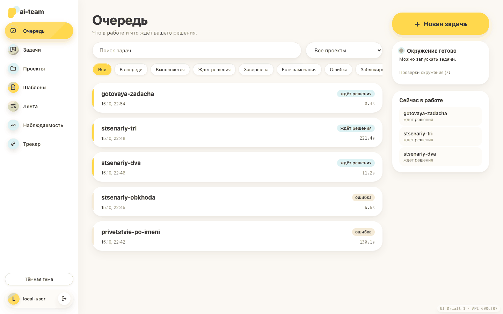
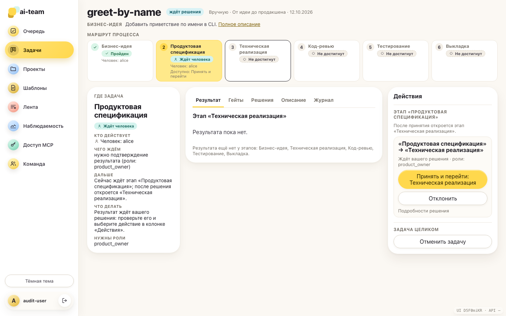
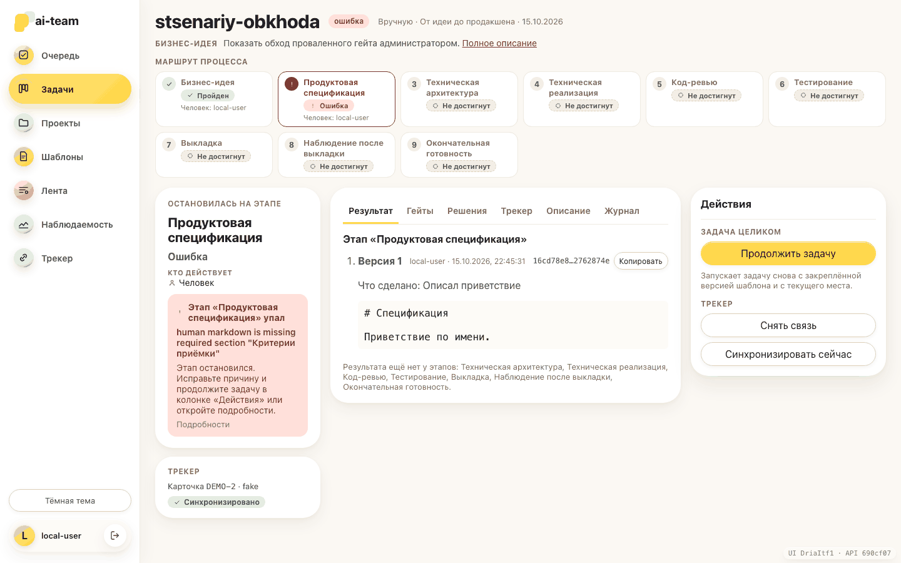
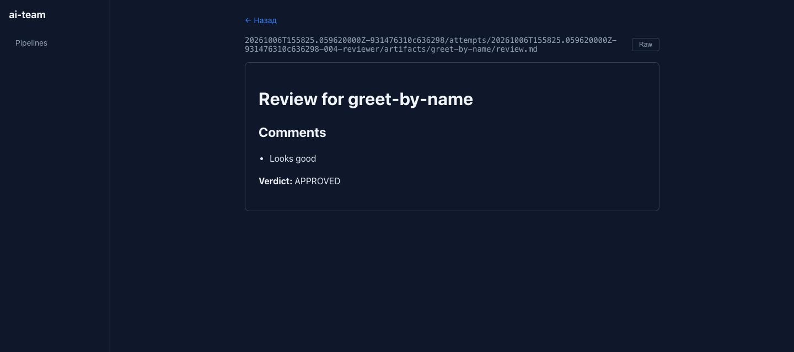
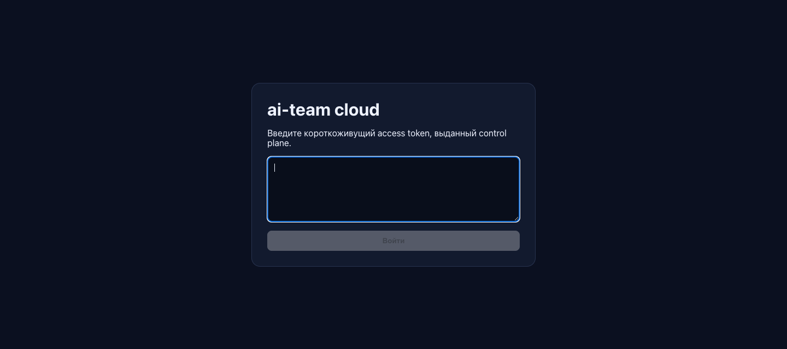

# Веб-дашборд

Дашборд показывает прогоны проекта в браузере: этапы, артефакты агентов,
подтверждения и итог. Из него же можно создать задачу, принять решение,
продолжить остановленный прогон и связать задачу с карточкой трекера. Дашборд встроен в CLI и запускается одной
командой.

> [!LEARN]
> - как открыть дашборд для своего проекта;
> - что показывает каждый экран;
> - как подтвердить delivery-план и продолжить прогон кнопками;
> - как включить вход по токену, если дашборд нужен не только вам.

## Что понадобится

- Собранный `ai-team` и проект после `ai-team init`.
- Браузер на той же машине.
- Для запуска прогонов из дашборда — то же, что для `ai-team run`: runtime в
  `PATH`, разрешённые ключи, `remote origin` и авторизованный `gh`.

## 1. Запустить дашборд

Из корня проекта выполните:

```bash
ai-team web
```

```text
Web UI available at http://127.0.0.1:8080
```

Откройте адрес в браузере. Порт меняется флагом `--port`, проект — флагом
`--target`. Остановить сервер — `Ctrl+C`.

Дашборд хранит свою базу в `.ai-team/web.db`. Туда же пишет и `ai-team run`
из терминала, поэтому в дашборде видны все прогоны проекта, где бы их ни
запустили.

> [!WARNING]
> Без входа по токену дашборд не проверяет, кто к нему обращается. Любой, кто
> достучится до порта, может запустить прогон и подтвердить delivery. Поэтому
> без токена сервер слушает только `127.0.0.1`: попытка указать другой адрес
> завершится ошибкой `web UI не имеет authentication и может bind только
> loopback host`. Не обходите это ограничение через проброс портов или прокси.

## 2. Где что находится



Меню слева; каждое слово — одна страница:

| Пункт | Что это |
|---|---|
| **Очередь** (`/`) | что сейчас в работе и что ждёт вашего решения, готовность окружения, кнопка **Новая задача** |
| **Задачи** | доска по этапам шаблона и список всех задач, фильтры по проекту, состоянию, этапу, функции и режиму |
| **Проекты** | папки для задач; создать и архивировать проект могут владелец продукта и архитектор |
| **Шаблоны** | активный шаблон процесса и его версии |
| **Лента**, **Наблюдаемость** | события всех задач; метрики потока |
| **Трекер** | только если подключён трекер: открытые входящие запросы, недоставленные события, опрос |
| **Доступ MCP** | личные токены для Claude и Codex (облачный режим) |
| **Команда** | участники и роли (облачный режим; владелец продукта) |

Задачу создаёт одна страница — **Новая задача**: проект, название, шаблон,
режим, текст идеи и внешние ссылки. Кнопку видят только роли с правом
`run:start` (владелец продукта и архитектор); остальные видят, кто может
создать задачу. Это то же, что `ai-team run --feature … --task …`.

> [!NOTE]
> Дашборд строже терминала. CLI запускает прогон, даже если не настроены
> remote или `gh`, а дашборд отказывает, пока не пройдены все пункты с
> пометкой `required`. Прогон из дашборда выполняется внутри процесса
> `ai-team web`, поэтому `PATH` и `AI_TEAM_HARNESS_ENV_ALLOW` должны быть
> заданы в окружении этого процесса.

Если список не загрузился, страница показывает причину и кнопку
**Повторить загрузку** — ошибка не выглядит как «задач нет».

## 3. Страница задачи: три зоны



Сверху — название, состояние задачи, строка о бизнес-идее и **Маршрут
процесса**: все этапы с их вычисляемым статусом (не достигнут, готов к работе,
в работе, проверяется, ждёт человека, пройден, отклонён, заблокирован,
пропущен). Щёлкните этап, чтобы посмотреть его результат. Ниже — три зоны, у
каждой неизменное назначение:

- **Статус и контекст** (слева): где задача, кто действует (человек,
  внутренний или внешний агент, ответственный), чего ждём и какие роли нужны,
  что проверяется (гейты этапа), состояние трекера и Git-доставки. Здесь нет
  кнопок.
- **Материалы** (по центру) — вкладки **Результат**, **Гейты**, **Решения**,
  **Трекер** (если он подключён), **Описание**, **Журнал**. Вопросы грилла,
  отчёт проверки, план доставки и форма результата стоят над вкладками.
  Всё объёмное — лог, артефакты, таймлайн, история решений — только здесь.
- **Действия** (справа): только то, что можно сделать сейчас вашей ролью.
  Колонка не растёт от логов и артефактов: на широком экране она закреплена и
  прокручивается внутри себя. Если действий нет, колонка говорит почему и какие
  у вас роли.

### Словарь действий

Одно действие — одно название везде: на кнопке, в строке «Доступно» маршрута и
в документации MCP.

| Действие | Кнопка |
|---|---|
| сдать результат человека | **Сдать результат** |
| взять этап / поручить агенту / сменить исполнителя | **Взять этап**, **Поручить агенту**, **Сменить исполнителя: на человека** |
| принять результат | **Принять и перейти: <этап>**, **Принять** (решение не уходит с этапа), **Принять и завершить задачу**, **Принять план доставки** |
| отказать | **Отклонить** |
| доработать | **Доработать агентом**, **Отправить новую версию**, **Вернуть на доработку: <этап>** |
| исключения (нужна причина) | **Пропустить этап**, **Обойти проверку** (только администратор) |
| вопросы грилла | **Ответить и продолжить**, **Завершить грилл без ответа** |
| гейты | **Повторить гейт: <имя>** (только технический сбой, на той же версии результата) |
| задача целиком | **Продолжить задачу**, **Выдать бюджет и продолжить**, **Отменить задачу**, **Повторить Git-доставку** |
| трекер | **Связать с карточкой**, **Снять связь**, **Повторить отправку в трекер**, **Синхронизировать сейчас**, **Закрыть запрос без действий** |

Принять ожидающее решение можно одной кнопкой: если оно доступно и как
подтверждение этапа, и как решение, колонка показывает одну кнопку. Жёлтая
кнопка в колонке одна и никогда не отказ.

### Роли и права

Интерфейс показывает действие только ролям, у которых оно есть на сервере;
остальным сообщает, кто может.

| Право | Роли |
|---|---|
| `run:start` — создать задачу | владелец продукта, архитектор |
| `run:resume` — продолжить | владелец продукта, архитектор, разработчик, тестировщик |
| `run:cancel`, `run:deliver` — отменить, повторить доставку | владелец продукта, менеджер выпуска |
| `project:manage`, `template:edit`, `tracker:link` | владелец продукта, архитектор |
| `artifact:edit` | владелец продукта, архитектор, ревьюер, тестировщик |
| `team:manage` | владелец продукта |
| `gate:override` — пройти после проваленного обязательного гейта | только администратор (системное право, не функция процесса) |

### Цвета

- **красный** — только настоящий отказ или обход: упавший этап или задача,
  проваленный или сломанный технически обязательный гейт, **обход провала**
  администратором, недоставленное в трекер событие;
- **янтарный** — только рекомендательный гейт, который не прошёл («Рекомендация
  не выполнена»); он ничего не блокирует;
- ожидание, неизвестное состояние и справочные подсказки — нейтральные или
  синие.

Обход проваленного гейта остаётся красным во всех представлениях: в маршруте,
на вкладке **Гейты**, в баннере и в истории. Исход самого гейта при этом по-прежнему
«Провал».

### Подтвердить план и продолжить прогон

Задача, которой нужно решение человека, получает статус «ждёт решения». Откройте
её: над вкладками стоит план доставки (ветка, файлы, сообщение коммита, текст PR),
а справа — хеш плана и кнопка **Принять план доставки**. Прочитайте
[delivery-план](../start/concepts.md#delivery-план) перед тем, как принять.

Решение, закрывающее этап, продолжает задачу само; если этого не случилось,
в блоке **Задача целиком** есть **Продолжить задачу**. **Отменить задачу**
отменяет прогон (статус `canceled`). Отказ у delivery-плана останавливает прогон со
статусом `STOPPED`, и delivery не будет.

> [!PITFALL]
> В профилях `standard` и `fast` подтверждения переходов между этапами
> отложены и закрываются одним решением о delivery. Дашборд показывает у них
> кнопки, но нажатие вернёт ошибку `deferred approval разрешается consolidated
> delivery-решением`. Принимайте решение у перехода с `trigger delivery_plan`.
> В профиле `regulated` каждый переход подтверждается отдельно.

### Если задача остановилась



Левая колонка называет этап, на котором задача остановилась, и показывает
короткую причину, не раскрывая ничего. **Журнал** хранит попытки, проверки и
логи; ссылка **Открыть лог** есть у каждой попытки.

### Трекер

Если подключён трекер (см. [Внешний трекер задач](../reference/config.md#внешний-трекер-задач)), задачу можно
связать ровно с одной карточкой. Слева видно карточку и состояние синхронизации,
справа — **Связать с карточкой** / **Снять связь**, **Повторить отправку в
трекер (N)** и **Синхронизировать сейчас**, во вкладке **Трекер** — недоставленные
события, конфликты связи и входящие запросы трекера. Входящий запрос не двигает
задачу сам: он показан с причиной и действием, которое разрешает контроллер, а
закрыть его без действий можно только с причиной. Страница **Трекер** в меню
собирает открытые запросы и недоставленные события по всем задачам. Менять связь
могут роли с правом `tracker:link`.

## 4. Разобрать завершённый прогон

Вкладка **Результат** показывает результаты этапов и ссылки на их файлы; щёлкните
этап в маршруте, чтобы увидеть его версии, хеши и сравнение версий. Вкладка
**Журнал** — таймлайн, попытки с проверками, мутациями и delivery, ссылка
**Открыть лог** (последние 64 KiB лога runtime) и лента событий.



Артефакт показывается как Markdown; кнопка **Raw** открывает исходный текст.
Путь вверху указывает, к какой попытке он относится. Это копия из
доказательств прогона (`.ai-team/runs/<run_id>/attempts/…`), а не текущий
файл в рабочем каталоге.

## 5. Включить вход по токену

Если дашбордом пользуются несколько человек или он работает на сервере,
включите вход по токену. Тогда сервер можно открыть и на другом адресе, а
каждое решение записывается от имени конкретного человека с проверенной
ролью.

1. Сгенерируйте общий секрет не короче 32 байт и задайте его в окружении
   сервера:

   ```bash
   export AI_TEAM_AUTH_SECRET="$(openssl rand -hex 32)"
   ai-team web --host 0.0.0.0 --port 8080
   ```

   Имя переменной меняется флагом `--auth-secret-env`. Если переменная пуста,
   вход выключен.

2. С тем же секретом в окружении выпустите токен для человека:

   ```bash
   ai-team auth-token --actor alice --roles release_manager,qa --ttl 8h
   ```

   Команда печатает токен вида `v1.eyJ…`. Роли: `product_owner`, `architect`,
   `developer`, `reviewer`, `qa`, `release_manager` и системное право `admin`
   (проводит задачу после проваленного обязательного гейта; выдаёт и снимает его
   только администратор — на странице **Команда** оно отмечено флажком
   «Администратор»). Срок жизни — не больше
   `24h`, по умолчанию `1h`.

3. Передайте токен человеку безопасным каналом. Он вставляет его на экране
   входа и нажимает **Войти**.



После входа браузер получает сессию на 8 часов. Решения записываются от
имени `--actor` из токена, а кнопки работают только для ролей из `--roles`.
Сессии хранятся в памяти сервера: после перезапуска `ai-team web` нужно
войти заново.

| Ошибка | Причина |
|---|---|
| `cloud identity: signing secret должен содержать минимум 32 байта` | Переменная с секретом не задана или секрет короче 32 байт |
| `cloud identity: token TTL должен быть в диапазоне (0, 24h0m0s]` | `--ttl` больше суток |
| `cloud identity: неизвестная роль "…"` | Роль не из списка выше |

> [!WARNING]
> Сервер дашборда отдаёт обычный HTTP без TLS. Открывая его в сеть, ставьте
> перед ним прокси с HTTPS, иначе токен и cookie сессии пойдут открытым
> текстом. Секрет `AI_TEAM_AUTH_SECRET` даёт право выпускать токены с любыми
> ролями: храните его как пароль администратора. И помните, что агенты
> выполняются с правами процесса `ai-team web` — это не песочница, см.
> [Граница безопасности](../reference/security.md).

## Что дальше

- [Остановки и BLOCKED](troubleshooting.md) — что делать, если прогон
  остановился.
- [Проверить и передать результат](evidence.md) — проверить доказательства и
  собрать пакет.
- [Команды CLI](../reference/cli.md) — все флаги `web` и `auth-token`.
