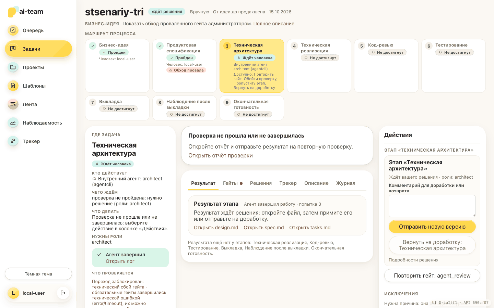
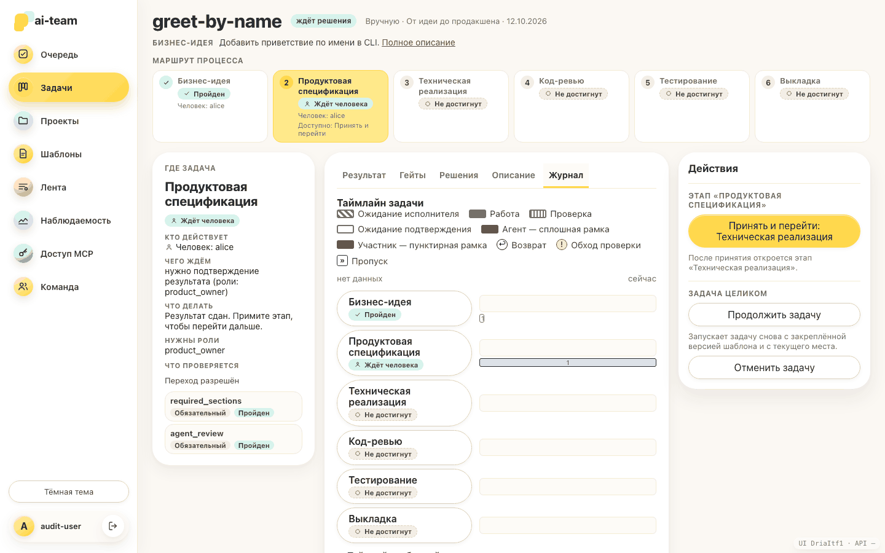

# Аудит Web UI (S16)

Что проверялось, что нашлось, что исправлено и что осталось. Снимки лежат рядом
(`*.png`, палитра сжата, всего около 2,5 МБ).

## Как проверяли

1. **Все состояния задачи на фикстурах** — `web/e2e/audit-fixtures.js` описывает
   ответ API для каждого состояния S11 и для S06/S14/S15, `web/e2e/ui-audit.spec.js`
   открывает страницу в настоящем браузере на собранном `web/dist` и проверяет
   «где задача / кто действует / что проверяется / следующее действие», отсутствие
   двух кнопок с одним названием, одну жёлтую кнопку, отсутствие горизонтальной
   прокрутки на 390 px и стабильность правой колонки. Снимки
   (светлая и тёмная тема, десктоп и 390 px):
   `UI_AUDIT_DIR=../docs/ui-audit npx playwright test e2e/ui-audit.spec.js` из `web/`.
2. **Проход на реальных данных** — `ai-team web` на проекте с шаблоном
   `idea-to-prod`, mock-opencode (`e2etest/mock-opencode.sh`), фейковым трекером
   (`tracker.adapter: fake`, входящие правила `advance` и `return`) и локальным
   токеном: создан проект «Платформа», пять задач, пройдены бизнес-идея
   (принятие), продуктовая спецификация (сдача результата, кодовый гейт
   `required_sections`, LLM-гейт `agent_review` с технической ошибкой, повтор,
   обход администратором с причиной), техническая архитектура, связь задачи с
   карточкой DEMO-1/DEMO-2, «Синхронизировать сейчас». Снимки `real-*.png`.
3. **Матрица ролей** — модульные тесты (`web/src/pages/TaskDetail.layout.test.tsx`,
   `permissions.test.ts`), Go-тест `viewer_actions` против реальных запросов и
   фикстуры «нет прав» и «разработчик на этапе владельца»: что видят владелец
   продукта, архитектор, разработчик, ревьюер, тестировщик, менеджер выпуска и
   администратор. Фикстуры собраны в форме реальных данных: подтверждение перехода —
   `kind: approve` с триггером `graph_outcome:<исход>` и `from_stage` ≠ `next_stage`;
   `stage_check` — только `check_decision`. Принятие идёт через настоящий путь
   карточки решения (`POST …/approvals/{id}/decisions` с `subject_hash`).

## Найдено и исправлено

### Структура страницы задачи

| Что было | Что сделано |
|---|---|
| Две равные колонки (идея слева, «текущий этап» справа); правая несла всё: вопросы грилла, JSON плана, формы, отчёты, статус агента — и росла без предела | Три зоны с неизменным назначением: слева статус и контекст (без кнопок), по центру материалы во вкладках, справа только действия; правая колонка закреплена, прокручивается внутри и не растёт от логов и артефактов (проверено 1500 событий и 400 артефактов) |
| Под этапом шесть длинных блоков: «Согласования», «Управление задачей», «Git-доставка», «Результаты этапов» (девять карточек «Результата пока нет»), «История грилла», «Обходы и рекомендации», свёрнутый «Журнал» | Вкладки «Результат», «Гейты», «Решения», «Трекер», «Описание», «Журнал»; пустые этапы — одной строкой; доставка — слева, управление задачей — справа |
| Маршрут «змейкой» с кружками и сырыми id этапов | Полоса этапов: статус, исполнитель, посещения, «Доступно: …»; на 390 px два столбца без прокрутки |
| Заголовок этапа брался из checkpoint и спорил с чипом статуса другого этапа | Заголовок и чип берут этап из проекции S11, «Дальше: …» объясняет переход |
| Остановившаяся задача: «Этап не выбран», пустое `Этап «»`, причина спрятана в «Подробностях» | «Остановилась на этапе «X»», короткая причина видна сразу |
| Порядок фокуса не совпадал с визуальным: в DOM шли статус, действия, материалы, а на десктопе глаз видит статус, материалы, действия | Порядок DOM равен визуальному на каждой ширине (сетка по областям, без `order`): статус, «Требует внимания», материалы, действия; на телефоне действия идут после материалов, поэтому ссылка «К действиям» в шапке видна и ведёт к колонке; вкладки по паттерну tablist (стрелки, Home, End), `aria-controls` указывает только на существующую панель. Тесты порядка: десктоп и телефон в `ui-audit.spec.js`, DOM в `TaskDetail.layout.test.tsx` |

### Названия и дубли

| Что было | Что сделано |
|---|---|
| Две страницы «Задачи» (меню «Задачи» → очередь, «Доска» → страница «Задачи») | «Очередь» (`/`) и «Задачи» (доска и список) |
| Три «создания»: «Создать задачу» на главной, «Новая задача» на доске, урезанная форма на главной (только для владельца продукта, без шаблона, режима и ссылок) | Один путь — страница «Новая задача»; на главной и доске одна кнопка «Новая задача»; права `run:start` у владельца продукта и архитектора, как на сервере |
| «Принять»: Подтвердить и перейти / Принять и перейти / Согласовать / Согласовать ТЗ… / Подтвердить план / Подтвердить результат; «Сдать»: Сдать / Отправить результат; обход: «Обойти проверку» и «Подтвердить без проверки»; новая версия: два названия; повтор: «Повторить на той же версии» и «Повторить одобренную Git-доставку»; лог: «лог этапа» и «лог агента»; три «Изменить: …» | Единый словарь `web/src/actionLabels.ts`; тест не допускает двух глаголов с одним названием |
| На данных: подтверждение этапа и решение «approve» одного согласования давали две кнопки «Принять и перейти» | Одна кнопка; решение принимается ролью, которую называет согласование |
| На данных: для этапа с результатом «approve» рядом стояли «Принять» и «Сдать результат» | Принимается решением, второй кнопки нет; «Принять» без «перейти: <тот же этап>» |
| На данных: «Вернуть на доработку» в карточке решения (`return_to_X`) и в форме исключений | Один путь: форма «Исключения» (возврат с причиной через `/return`); решение не дублирует маршрут, который она уже предлагает; название везде «Вернуть на доработку: <этап>» |
| Пока ждёт подтверждение перехода, `state.next_stage` — этап назначения, а подтверждается `from_stage`; «Вернуть», «Пропустить» и «Обойти» целились в `next_stage`, заголовок группы — в другой этап | Маршруты возврата, возврат, подтверждение и заголовок берут один этап: `from_stage` ожидающего подтверждения, иначе этап проекции S11. Сервер перестал предлагать `skip` вне ввода человека и считает `return` от `from_stage`. Тесты: vitest и сценарий `transition-return` (запрос уходит на `/stages/code_review/return`) |
| Жёлтая кнопка могла оказаться «Отклонить» | Главная кнопка одна и не отказ, не возврат, не обход |

### Скрытые функции

| Что было | Что сделано |
|---|---|
| «Пропустить», «Вернуть», «Обойти проверку» — внутри `
` «Другие действия…»; обход в двух местах | Группа «Исключения» в колонке действий, формы видны всегда, обход один |
| Действия API/MCP `take` и `executor` без кнопок | «Взять этап»; «Сменить исполнителя: на человека» (когда этап отдан агенту) |
| Трекер (S14/S15) не имел интерфейса | Сводка слева, действия справа (`tracker:link`), вкладка «Трекер», страница «Трекер» по всем задачам: связь, снять связь, повторить отправку, синхронизировать сейчас, конфликты, входящие запросы, закрытие запроса с причиной |
| Роли команды правились через `window.prompt` (текст через запятую); права администратора не было в списке; отзыв доступа и токена MCP — `window.confirm` | Флажки всех ролей, включая «Администратор» (отключён не-администраторам с объяснением); подтверждение на месте; ошибки сервера (последний администратор) видны |

### Роли

| Что было | Что сделано |
|---|---|
| Кнопки «Продолжить», «Отменить», «Повторить доставку» видели все | Только роли из серверной таблицы; остальным «Продолжить задачу могут: …» |
| Действия над этапом («Взять этап», «Сдать результат», «Пропустить», «Поручить агенту», «Принять», «Вернуть») показывались по `allowed_actions`, которое от роли не зависит: разработчик на этапе владельца продукта видел кнопки и получал 403 | Сервер отдаёт в `GET /api/runs/{id}` аддитивное поле `viewer_actions`: часть `allowed_actions`, разрешённая именно этому участнику теми же проверками, что и выполнение (функция этапа, право администратора, роли плана, самоподтверждение). Кнопка показывается по пересечению; без права вместо кнопок «Нужна роль: …». Таблицу прав в интерфейс не копировали. Тест `viewer_actions` против реальных запросов (`pkg/web/viewer_actions_test.go`) |
| Редактирование ролей администратора блокировалось для владельца продукта целиком, хотя сервер запрещает только менять само право `admin` | Кнопка «Изменить роли» доступна, флажок «Администратор» заблокирован; отзыв доступа администратора по-прежнему только администратору |
| «Создать задачу» только владельцу продукта, хотя сервер разрешает и архитектору | `web/src/permissions.ts` повторяет `cloudidentity.Authorize` (тест на всю матрицу) |
| В подсказке ролей и на странице команды не было «администратор» | Добавлено |
| Пустая колонка действий без объяснения | «Сейчас у вас нет доступных действий. Ждём: … Ваши роли: …» |

### Цвет, иконки, типографика

| Что было | Что сделано |
|---|---|
| Юникод-значки ⛔ ⏸ ⟳ и эмодзи 🤖 — разный вид в разных ОС | Один набор SVG-значков (`Icon`), одинаковый чип статуса везде |
| Технический сбой обязательного гейта — янтарным; «ожидание перехода» — красным; «статус неизвестен» — янтарной точкой; жёлтая декоративная панель решения; чип роли администратора мог читаться как отказ | Красный — только отказ/обход (сбой гейта — красный пунктиром); янтарный — только рекомендация; ожидание и «неизвестно» нейтральны; роль администратора — пунктирный контур |
| Заголовки блоков 11–20 px вперемешку | Подписи блоков слева одним стилем (малые заглавные), один размер заголовков в зонах |

### Состояния ошибок и пустоты

| Что было | Что сделано |
|---|---|
| Очередь и доска глотали ошибку API (`console.error`), показывая «задач нет» | Ошибка с причиной и «Повторить загрузку»; пустое состояние называет первый шаг |
| Создание задачи: «preflight failed: delivery_remote: …» | «Окружение не готово к запуску: …» |
| Без права создавать задачи — пустое место | «Создавать задачи могут: Владелец продукта, Архитектор» |
| Остатки шаблона Vite (`App.css`, `assets/*`) | Удалены |

## Снимки

Состояния задачи (светлая тема, десктоп; ключевые — ещё `-dark-desktop`,
`-light-mobile`, `-dark-mobile`):

| Состояние | Снимок |
|---|---|
| Готов к работе: человек | `ready-human-light-desktop.png` |
| Этап отдан агенту человеком | `agent-override-light-desktop.png` |
| В работе: человек / внутренний агент / внешний агент | `working-human-…`, `working-agent-…`, `working-external-…` |
| Проверяется | `checking-light-desktop.png` |
| Ждёт человека: результат, вопросы грилла | `awaiting-human-…` (все четыре варианта), `grill-light-desktop.png` |
| Пройден | `passed-light-desktop.png` |
| Заблокирован (обязательный гейт), ошибка технического гейта с повтором | `blocked-gate-…` (все четыре варианта), `gate-error-light-desktop.png` |
| Отклонён / возврат, второе посещение / пропущен / прервана | `rejected-…`, `returned-second-visit-…`, `skipped-stage-…`, `interrupted-…` |
| Обход администратором (красный) | `override-…` (все четыре варианта) |
| Рекомендация не выполнена (янтарный) | `advisory-light-desktop.png` |
| Трекер: конфликт и входящий запрос, не связана, нет прав | `tracker-conflict-…` (все четыре варианта), `tracker-unlinked-…`, `no-rights-…` |
| Стабильная правая колонка при огромном журнале | `stable-actions-column-huge-log.png` |
| Пустые состояния, команда, трекер, MCP | `queue-empty-…`, `tasks-empty-…`, `team-roles-…`, `tracker-overview-…`, `mcp-access-…` |

Реальные данные (`real-*.png`): очередь (десктоп и 390 px), доска, проекты, новая
задача, готовая задача, задача с технической ошибкой гейта (светлая, тёмная,
390 px и колонка действий на телефоне), вкладка «Гейты» с обходом, остановившаяся
задача, вкладка «Трекер», страница «Трекер».

## Что осталось и ограничения

- Ошибка сервера с ролью подтверждения (`/confirm` брал функцию следующего этапа)
  исправлена в S13: подтверждение принимает `stage_id` подтверждаемого этапа
  (`from_stage` согласования) и проверяет функцию именно его. Интерфейс больше ничего
  не обходит: подтверждение этапа без карточки решения идёт через `/confirm` с этим
  этапом, а карточка решения (`graph_outcome:<исход>`) остаётся единым путём
  принятия, пока она есть. Сквозной проход подтверждения на реальном сервере и по MCP
  входит в S17.
- `viewer_actions` не заменяет окончательную проверку: сервер по-прежнему отвечает
  403 на действие без права; поле нужно только чтобы не показывать кнопку, которая
  заведомо не сработает. Пустой список приходит только запросу без сессии. В локальном
  режиме (`ai-team web` без `--auth-secret-env`, сессия по локальному токену) участник
  `local-user` держит все роли процесса и право `admin`, поэтому видит все действия,
  разрешённые состоянием задачи; матрицу ролей локально не проверить.
- Снимки новых и изменённых состояний (`awaiting-human-*`, `advisory-*`, `no-rights-*`,
  `developer-on-owner-stage-*`, `transition-return-*`) сняты без сжатия палитры и
  тяжелее прежних; остальные сохранены как были.
- В `PipelineCard` карточка с `role="link"` содержит кнопку «Отменить задачу»
  (вложенный интерактивный элемент); не менялось.
- На телефоне до колонки действий идут меню, маршрут, статус и материалы (порядок
  фокуса равен визуальному); смягчено видимой ссылкой «К действиям», но первый экран
  по-прежнему занят меню Layout.
- «Лента», «Наблюдаемость», «Шаблоны» и просмотр артефакта прошли только проход по
  словарю, правам и цвету, без перерисовки.
- Состояния, которых не было в проходе на реальных данных (внешний Docker-исполнитель,
  рекомендательный гейт, входящий конфликт трекера), показаны на фикстурах, а не на
  живой задаче; сквозной проход с Docker, обходом и трекером в локальном режиме сделан
  позже в [демонстрации](../demo/README.md). Страницы «Команда» и «Доступ MCP» работают
  только в облачном режиме с личностью и в локальном режиме на живых данных недоступны:
  они показаны только на фикстурах.
- Первый браузерный сценарий `queue-flow.spec.js` (планировщик с bubblewrap)
  выполняется только на Linux и на macOS пропускается.
- Старые снимки в `docs/assets/screens` (другие руководства) не пересняты.
